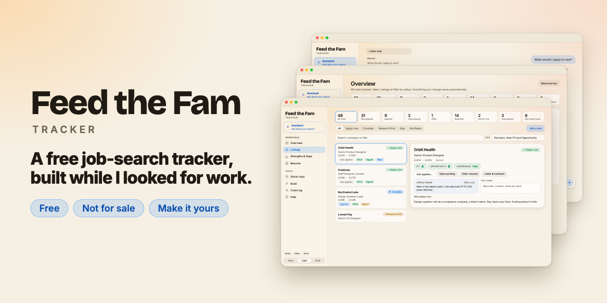

# Feed the Fam Tracker



A free job-search tracker I built while I was looking for work. It keeps every role in one place, grades each one honestly, and helps with the next step. **It is not for sale, and it never will be.** Take it, change it, make it fit your role.

> I got laid off. My neighbors and my community are going through the same thing, and the not-knowing is its own kind of stress. I'm not going to charge anyone for help.
> — David Rivas

## What it does

- **Keeps your search in one place.** Add a role by pasting a link, pasting a job description, or typing it in. See every status at a glance, with a timeline of applications, rejections, interviews and "not heard back."
- **Grades each role honestly.** Pass-or-fail gates (pay, remote, employment type, and more), then **Fit** (can you win it?) and **Opportunity** (is it worth having?) from A to F, with the reasons. A strengths-and-gaps web shows where you are strong and where you are not.
- **Helps with the next step.** Tailor your résumé to a posting using only facts from your own résumé, draft cover letters and outreach (nothing is sent for you), prepare for interviews, and ask an assistant what to apply to next.
- **Turns gaps into projects.** Generate or write Build ideas, and track each one from Idea to Shipped.
- **Looks after you too.** An hourly pep talk from future you, because the search is a mental game.

## How it works

Two parts do different jobs:

| In the page | In Claude Code |
| --- | --- |
| Grade and explain roles | Search job boards for new roles |
| Tailor your résumé | Grade lots of roles at once |
| Letters, outreach, interview prep | Evaluate roles you add by link or paste |
| The Assistant | Read Gmail for status updates (optional) |
| Runs on **your own Claude account** | Runs on **your computer** |

**It does not fill out or submit applications for you.** You still apply yourself. The tracker helps you decide where to spend your energy and gets your materials ready. Your data stays in your Claude account and your browser, and this repository contains none of anyone's personal data.

## What you need

- A Claude account (the AI parts of the page run on your own subscription).
- [Claude Code](https://docs.claude.com/en/docs/claude-code/overview) for searching and bulk grading. It is optional, and the page has a built-in "New to Claude Code?" guide.
- Python 3 and Git (both are standard on a Mac).

The tracker itself is free. The AI runs on your Claude account, so that part has whatever cost your plan has.

## Quick start

1. Get the code into a folder called `job-search` in your home folder:
   ```bash
   git clone https://github.com/rivasme/feed-the-fam-tracker.git ~/job-search
   cd ~/job-search
   ```
2. Open Claude Code in that folder:
   ```bash
   claude
   ```
3. Ask it: *"Build the tracker page with `python3 tracker-app/build.py` and publish it as an Artifact. Give me the link."*
   If your Claude Code can't publish Artifacts, build a local copy with `python3 tracker-app/build.py tracker.html` and open it in your browser. A local copy is good for tracking, but the in-page AI features need the page to run inside Claude.
4. Open the page. A short welcome tour asks for your name, your résumé (upload a PDF, Word or text file, or paste it), and what you want. It then gives you copy-ready prompts for Claude Code.
5. Add your first role and let the grading do its thing.

## Make it yours

Built for designers first, but it is meant to be reverse engineered:

- **Swap the gates.** Your pay floor, remote rules and what you will never do. See `grading/rubric-v2.md` and `grading/profile.template.md`. The tour's Claude Code prompt fills in your own `grading/profile.md`, which stays on your computer.
- **Rewrite the rubric.** Decide what a strong match means in your field.
- **Change the Build ideas.** Portfolio projects that fit the role you want.
- **Make the pep talks yours.** Edit the messages in `tracker-app/template.html`.
- **Change anything else.** You do not have to write code by hand. Open Claude Code in this folder and tell it what you want to change.

Engineers, product managers, data people, writers, designers: please make a version that fits your role and tell me about it.

## Tell me how it went (this is the review)

GitHub has no star ratings for projects, so here is what works:

- **Start a Discussion** in *Show and tell*: what you changed, what role you made it for, and what you learned.
- **Open an issue** with the *How it went* form: what worked and what broke.
- **Star the repo** so other people searching can find it.
- **Send a pull request** if you fixed or improved something. Code review is welcome.

Please never include your résumé, contact details or real application data in an issue, discussion or pull request. See [CONTRIBUTING.md](CONTRIBUTING.md).

## License

This project uses the **PolyForm Noncommercial License 1.0.0** (see [LICENSE](LICENSE)). In plain English:

- You can use it, copy it, change it and share it for any noncommercial purpose, including your own job search and helping people in theirs. Charities, schools and public-interest groups can use it too.
- You can't sell it, charge for it, or build a paid product or service out of it. Don't take this and make money on it. That's a low.
- If your intended use is unclear, open a Discussion and ask.

This summary is not legal advice. The LICENSE file is what counts.

## Credits

Built by [David Rivas](https://www.iamdavidrivas.com) with [Claude Code](https://docs.claude.com/en/docs/claude-code/overview). David is a designer who does not write code by hand: he directs Claude Code and reviews what it makes.
