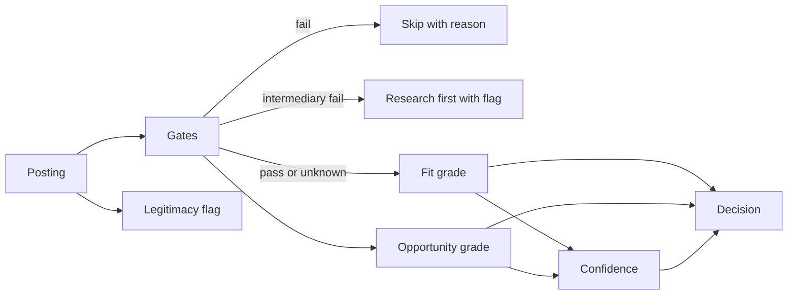

# Grading spec v2

How the tracker decides which roles deserve your time. The rules are fixed so grades stay consistent between roles and between graders; the values that are personal (pay floor, location, levels, target roles) come from your profile.

## 1. The model in one view

Outputs per role: gate results, a Fit letter, an Opportunity letter, a decision, a confidence label, an optional legitimacy flag, and the reasons for each. Letters are plain A, B, C, D, F with no plus or minus. Claude Code graders write the dimension grades; `grading/grade_v2.py` computes the letters, confidence and decision.

## 2. Gates

A gate is one of your own must-haves, checked before grading. It has three outcomes: pass, fail, or unknown. The values below come from your profile (`min`, `city`, `remote`, `types`, `avoid`).

| Gate | Rule | Fail means | Unknown means |
|---|---|---|---|
| Pay floor | Posted base is at least your minimum; a range passes when its top reaches the minimum | Whole range, or the single figure, under it: Skip | Pay not stated: Research first |
| Remote | Matches your remote setting and location | An arrangement you ruled out, or a location restriction that excludes you: Skip | Remote terms unclear: Research first |
| Employment type | One of the types you allow | Any other type: Skip | Not stated: pass |
| Degree | No hard degree requirement, "or equivalent", or you have it | A hard requirement you do not meet: Skip | Not stated: pass |
| Eligibility | No clearance, ITAR or work-authorization blocker | Any such blocker: Skip | Not stated: pass |
| Liveness | The posting opens and is listed | Closed or missing: Skip | Could not check: pass, noted |
| Avoid list | Company and role are not on your avoid list | On the list: Skip | n/a |
| Intermediary | The posting names the employer | Unnamed client: Research first (flag) | n/a |

Rules: a failed gate never changes a letter; it sets the decision to Skip (a failed Intermediary gate gives Research first only when the role would otherwise be Apply now or Consider). The role is still graded so you can override. Hourly pay is annualized by 2,080 hours.

## 3. Fit grade (can you win it?)

| Dimension | Weight | What it judges |
|---|---|---|
| Skills and experience match | 35% | Core duties against work you have done and can show |
| Seniority and scope | 25% | Level and years asked against your real years in relevant roles |
| Domain and target-role match | 20% | Match against the roles you are looking for |
| Evidence for this posting | 20% | Requirement by requirement, below |

Evidence is judged per posting, not against your standing gap list: extract up to 8 key requirements, mark each must or nice, mark each supported, partial or missing using only your confirmed facts, then `grade_v2.py` computes the letter (A if every must-have is supported; B if none is missing and at least half are supported; C if none is missing but under half are supported, or one is missing and at least half of the others are supported; D if one is missing otherwise, or two are missing; F if more than two are missing).

Cutoffs on the weighted average (A=4, B=3, C=2, D=1, F=0): A at 3.4 or higher, B at 2.6, C at 1.8, D at 1.0, F below. Cap: an F on seniority caps Fit at C.

## 4. Opportunity grade (is it worth having?)

| Dimension | Weight | A | C | F |
|---|---|---|---|---|
| Compensation | 40% | Floor at or above your target | Pay not stated, or the range straddles your minimum | Floor well under your minimum |
| Location and remote terms | 25% | Your location is stated as eligible | Remote implied, location not stated | Onsite or excluded |
| Level and scope | 20% | Exactly your target level | One step off | Three or more steps off |
| Company stage and risk | 15% | Funded, stable, clear product | Unknown or mixed | Evident distress |

Dimensions with no information are left out and lower confidence; they are never guessed. Same letter cutoffs and the same cap (an F on compensation caps Opportunity at C).

## 5. Decision

| Fit \ Opportunity | A | B | C | D or F |
|---|---|---|---|---|
| A | Apply now | Apply now | Consider | Consider |
| B | Apply now | Apply now | Consider | Skip |
| C | Consider | Consider | Skip | Skip |
| D or F | Skip | Skip | Skip | Skip |

Overrides, in order:
1. Any failed gate other than Intermediary sets the decision to Skip, with the reason.
2. A failed Intermediary gate counts like an unknown gate: it turns an Apply now or Consider result into Research first.
3. Otherwise, if the matrix says Apply now or Consider and a gate is unknown or confidence is Low, the decision becomes Research first.
4. Ungraded roles are Not Rated.

An override ("Apply anyway") is one click in the page and is recorded on the role. Sorting: decision order (Apply now, Consider, Research first, Skip), then Fit, then Opportunity, then posted pay.

## 6. Confidence

Shown as High, Medium or Low beside the letters. It never changes a letter.

| Level | Rule |
|---|---|
| High | At least 7 of the 8 Fit and Opportunity dimensions had evidence, and the full posting text was available |
| Medium | 5 or 6 dimensions had evidence, or only the saved notes were available |
| Low | 4 or fewer dimensions had evidence, or only a title and company were available |

## 7. Posting legitimacy flag

A flag for postings that may be fake, stale or misleading. It records observations, not verdicts, and does not change a grade or decision: an unnamed employer or client, an old or reposted listing, an early request for payment or sensitive information, vague duties, or a pay range that does not make sense. Output: none, or "Check this posting" with up to three reasons and quotes.

## 8. Changing the rules

The weights, cutoffs and decision matrix live in `grading/grade_v2.py` and `tracker-app/template.html`. Change them in both places together, and only on purpose: grades from before the change are no longer comparable. Personal values (pay, location, levels, target roles) never need a code change; they come from your profile.
